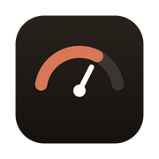
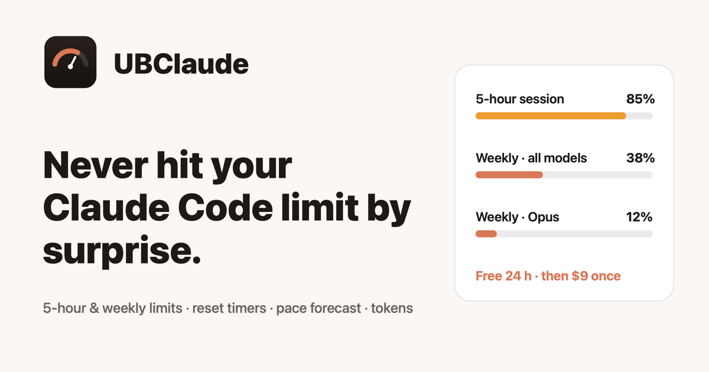
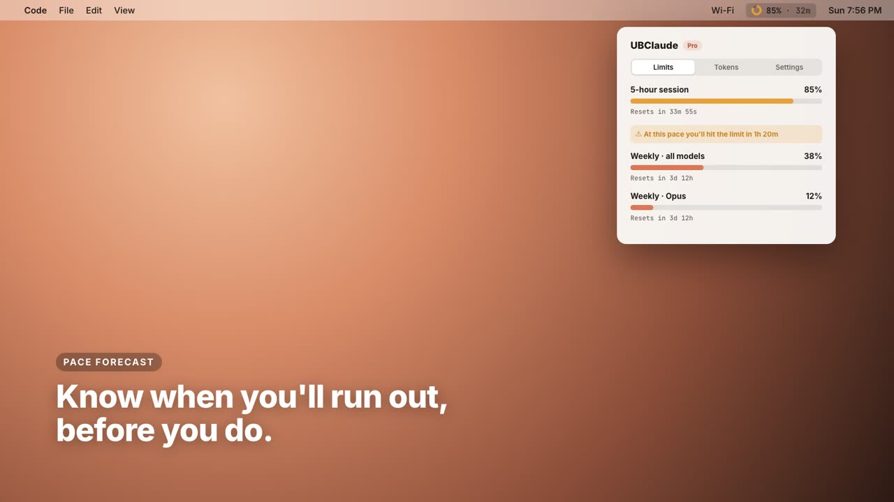

<h1 align="center">UBClaude</h1>

<b>Your Claude Code usage limits, live in the Mac menu bar.</b>

<a href="../../releases/latest"><b>⬇ Download for Mac</b></a> · <a href="docs/README.md">Documentation</a> · <a href="https://usagebarclaude.com/?utm_source=github&utm_campaign=readme">Website</a> · <a href="https://usagebarclaude.com/guides?utm_source=github&utm_campaign=readme">Guides</a>

Free for 24 hours · then $9 once · <b>not open source</b> (proprietary, see <a href="LICENSE">LICENSE</a>)

UBClaude is a tiny native macOS app that shows your **Claude Code 5-hour session and weekly limits** in the menu bar, with reset countdowns, alerts and a forecast of when you'll run out. No more getting cut off in the middle of a refactor.

## Features

- **5-hour session and weekly limits** at a glance, including per-model weekly limits on plans that have them
- **Reset countdowns** for every limit
- **Alerts** at 50%, 75% and 90%, plus a notification when your session resets
- **Pace forecast**: "at this pace you'll hit the limit in 1h 20m"
- **Token stats** (today, 7 days, month, per model), counted locally from Claude Code's logs
- Choose what the menu bar shows · light and dark mode · launch at login

## Private by design

No account. UBClaude uses the Claude Code login already stored on your Mac and only talks to Anthropic to read your usage. Token stats are counted locally; nothing is sent anywhere else.

## Install

1. Download **UBClaude.dmg** from the [latest release](../../releases/latest).
2. Drag UBClaude into Applications and open it: it appears in the menu bar.
3. Use it free for 24 hours, then activate with the key from your purchase email.

Full guide: [docs/installation.md](docs/installation.md) · [Free trial and activation](docs/activation.md) · [Troubleshooting](docs/troubleshooting.md) · [FAQ](docs/faq.md)

## Requirements

- macOS 13 Ventura or later, Apple Silicon or Intel
- Claude Code with a Claude Pro or Max plan

## Price

**Free for 24 hours**, then **$9 once**: a lifetime licence for up to 3 Macs, with every future update.
Get it at **[usagebarclaude.com](https://usagebarclaude.com/?utm_source=github&utm_campaign=readme)**.

## Learn more about Claude usage limits

- [Claude Code usage limits explained](https://usagebarclaude.com/claude-code-usage-limits)
- [The Claude 5-hour limit](https://usagebarclaude.com/claude-5-hour-limit)
- [The Claude weekly limit](https://usagebarclaude.com/claude-weekly-limit)
- [4 ways to check your Claude Code usage](https://usagebarclaude.com/check-claude-code-usage)
- [UBClaude vs ccusage](https://usagebarclaude.com/ubclaude-vs-ccusage)

## Feedback and support

Found a bug or have an idea? [Open an issue](../../issues) or email **contact@usagebarclaude.com**.

---

**Licence:** proprietary, all rights reserved. This repository contains documentation and official builds only; the source code is not published. See [LICENSE](LICENSE).

UBClaude is an independent app made by North Stack Digital Ltd. It is not affiliated with, endorsed by or sponsored by Anthropic. Claude and Claude Code are trademarks of Anthropic PBC.
